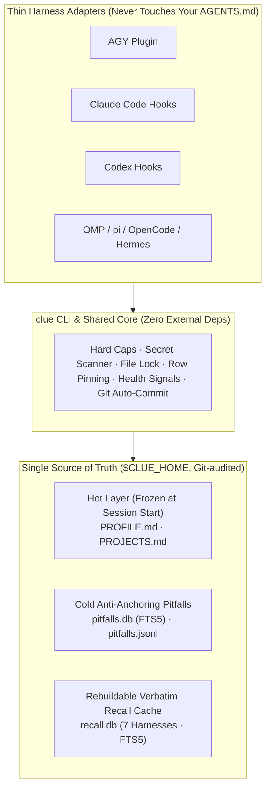

# clue

**Local-first, bounded, anti-anchoring personal memory & cross-harness session recall for AI coding agents.**

English | [简体中文](./README.zh-CN.md)

---

`clue` gives every AI coding harness you use — **Antigravity (AGY)**, **Claude Code**, **Codex**, **OMP**, **pi**, **OpenCode**, and **Hermes** — one tiny, Git-audited source of truth for who you are, how you work, what traps you've hit, and what you actually said in past sessions.

Zero cloud services. Zero always-on MCP bloat. Zero vector databases. Zero runtime dependencies beyond [Bun](https://bun.sh).

## Why `clue`?

Recent research exposed two uncomfortable truths about agent memory:

1. **Heavy memory pipelines often underperform direct search** (*[Memory Tax](https://arxiv.org/abs/2610.34073)*): aggressively summarizing or restructuring conversations introduces *faithfulness loss*, *retrieval mismatch*, and *cross-model fragility* — a memory written by Model A often degrades Model B.
2. **Preloaded context must stay tiny, and stale notes are worse than no notes** (*[The Components of Agent Memory](https://www.anthropic.com/research/components-of-agent-memory)*): longer instruction files reduce adherence, while unverified notes anchor future sessions into repeating the same mistakes.

`clue` is built directly around those findings:

| Layer | File | Purpose | Token Cost |
| :--- | :--- | :--- | :--- |
| **Hot Layer** | `PROFILE.md` + `PROJECTS.md` | Who you are + global habits + **only the current repo** (worktrees auto-normalized) | Tiny & frozen per session (`≤1500` + `≤900` chars) — prompt cache stays intact |
| **Cold Pitfalls** | `pitfalls.db` + `pitfalls.jsonl` | Anti-anchoring bug root causes (`root_cause` separated from `historical_fix`, plus `rethink_hint` & `evidence`) | **0 tokens** until searched (`clue search`) |
| **Verbatim Recall** | `recall.db` *(rebuildable cache)* | Incremental SQLite FTS5 search across all 7 harnesses' raw transcripts (including `.jsonl.zst` Codex rollouts) | **0 tokens** until searched (`clue recall` / `clue show --around`) |
| **Audit & Guardrails** | Local `.git` + Hook guards | Hard caps, secret/prompt-injection scanning, row-level pinning, file locking, auto-commit & `clue undo` | **0 tokens** |

## Core Features

- **Code Guardrails over Model Discipline**: Single-line bullets (`≤160` chars), fixed sections, page hard-caps (`PROFILE` 1500 chars, `PROJECTS` 900 chars per scope). Overflow is rejected atomically, forcing consolidation instead of bloat.
- **Draft-First Curation (No Silent Background Writes)**: Sessions stay silently read-only during normal work. On wrap-up or casual close, the agent proposes a concise draft for your approval before calling `clue curate` or `clue pitfall`.
- **Anti-Anchoring Pitfalls with Traceable `evidence`**: Every pitfall separates objective `root_cause` from `historical_fix` and carries a `rethink_hint` + `evidence` anchor (commit, file path, or session ID) so stronger future models verify ground truth and `supersede` old workarounds.
- **Cross-Harness Verbatim Recall (`clue recall`)**: Incrementally indexes raw transcripts from **AGY, Claude Code, Codex (including zstd `.jsonl.zst`), OMP, pi, OpenCode, and Hermes** with automatic secret `[REDACTED]` scrubbing, subagent/cron noise demotion, and bounded `--around` window expansion (preventing massive tool logs from blowing up context).
- **Zero-Cost Health Signals + `clue dream`**: Local heuristics track capacity (`≥80%`), time elapsed, write count, and near-duplicate entries at zero token cost. When a signal turns yellow, `clue` gently suggests running `clue dream` to audit, merge, prune, and verify against recent transcripts.
- **Hard Security & Concurrency Guarantees**: Built-in secret scanner blocks API keys, tokens, PEM private keys, and prompt-injection tags; cross-process file locking + atomic writes prevent corruption when multiple harnesses run in parallel; `PreToolUse` hooks block raw file edits bypassing validation.

## Architecture



## Quick Start

### 1. Clone & Link `clue`

Requires [Bun](https://bun.sh) `>= 1.2.0` and `git`.

```bash
git clone https://github.com/henryyu333/CLUE.git ~/workspace/clue
mkdir -p ~/.local/bin
cat <<'EOF' > ~/.local/bin/clue
#!/bin/sh
set -eu
BUN="$(command -v bun 2>/dev/null || echo /opt/homebrew/bin/bun)"
export CLUE_HOME="${CLUE_HOME:-$HOME/.clue}"
if [ "${1:-}" = "hook" ]; then
  "$BUN" "$HOME/workspace/clue/src/cli.ts" "$@" || printf '{}\n'
  exit 0
fi
exec "$BUN" "$HOME/workspace/clue/src/cli.ts" "$@"
EOF
chmod +x ~/.local/bin/clue
```

### 2. Verify & Index Past Sessions

```bash
clue doctor      # Initializes $CLUE_HOME (Markdown + SQLite + Git)
clue status      # Check capacity, health, and recent pitfalls
clue index       # Incrementally index past transcripts across all detected harnesses
clue sources     # Inspect indexed session counts per harness
```

### 3. Connect Your Harnesses

`clue` never modifies your global `AGENTS.md` / `CLAUDE.md`. Install thin adapters per harness (automatic backups are created before editing existing config files):

```bash
clue install agy      # Installs native AGY plugin (~/.gemini/config/plugins/clue/)
clue install claude   # Merges SessionStart / UserPromptSubmit / PreToolUse hooks + Skill
clue install codex    # Merges UserPromptSubmit (--with-boot) hook + Skill
clue install hermes   # Installs Skill & prints config.yaml hook snippet
```

Add `--dry-run` to preview changes first. For **OMP**, **pi**, and **OpenCode**, import `src/core/index.ts` directly (or invoke `clue`) from a thin extension/plugin.

## CLI Reference

| Command | Description |
| :--- | :--- |
| `clue boot [--cwd <dir>] [--format text\|agy\|claude\|json]` | Render frozen hot-layer snapshot for the current repo |
| `clue status [--cwd <dir>] [--json]` | Zero-token capacity, health status, recent pitfalls & commits |
| `clue view [--cwd <dir>]` | Print live `PROFILE.md` and `PROJECTS.md` before proposing edits |
| `clue search "<query>" [--project <key>] [--limit 4]` | Search anti-anchoring pitfalls with FTS5 + CJK fallback |
| `clue recall "<query>" [--harness <name>] [--since 30d]` | Search verbatim past conversations across all 7 harnesses |
| `clue show <id-prefix> [--around <seq>] [--window 4] [--full]` | Expand bounded conversation context around a recall hit |
| `clue index [--harness <name>] [--rebuild]` | Incrementally refresh (or rebuild) `recall.db` |
| `clue sources` | List indexed session and message counts by harness |
| `clue curate [--dry-run]` *(stdin JSON)* | Atomically add/patch/remove hot-layer entries with hard caps & Git commit |
| `clue pitfall` *(stdin JSON)* | Add, update, `supersede`, or delete a pitfall with `evidence` |
| `clue dream [--mark-done]` | Generate memory health & consolidation packet (or mark audit complete) |
| `clue log [--limit 10]` / `clue undo` | Inspect memory Git history or safely revert the latest commit |
| `clue doctor` | Validate storage paths, Git repo, and SQLite FTS5 health |

## Optional Configuration (`$CLUE_HOME/clue.config.json`)

Keep personal limits, sections, or project-specific workflow reminders inside your private data directory — never in source code:

```json
{
  "limits": {
    "profileChars": 1500,
    "globalProjectChars": 900,
    "singleProjectChars": 900,
    "entryChars": 160,
    "dreamWarnPct": 80,
    "dreamMaxDays": 14,
    "dreamMaxWrites": 10
  },
  "projectWorkflows": [
    {
      "name": "team-handoff",
      "detectFile": "docs/STATUS.md",
      "startHint": "Found `{file}`: read project status before starting.",
      "wrapUpHint": "Update `{file}` and commit inside `{dir}` before finishing."
    }
  ]
}
```

## Development

```bash
bun test
```

## License

[MIT](./LICENSE)
